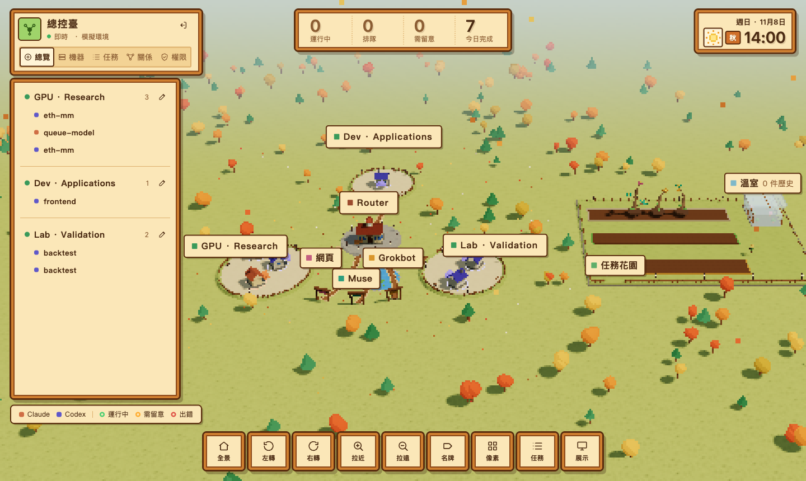
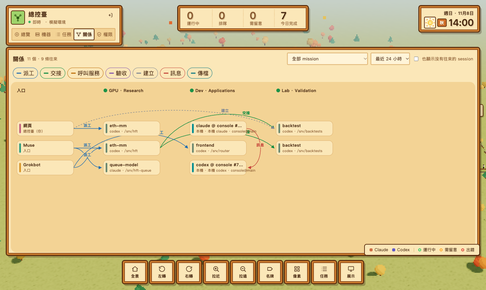

# Paseo Session Router

**One control service for the coding agents on all your machines.** It connects to the Paseo daemon on each machine, keeps one directory of every Claude Code and Codex session, and lets you, a planner agent, chat assistants and the agents themselves hand out work, queue it, approve it and follow it through, from a web console, a CLI, HTTP or MCP.

[繁體中文說明](README.zh-TW.md)



> Unofficial and not affiliated with Paseo. You need Paseo running on the machines you connect; the Router talks to it through Paseo's own client SDK.

## What it does

- **One directory across machines.** Every Paseo session on every connected daemon, reached through the Paseo relay with end-to-end encryption to each daemon's pinned key: no open ports and no SSH needed.
- **Dispatch that never interrupts.** A busy session is never cut off: new work waits its turn, one turn each, in order. Retries are idempotent, and a send whose outcome is unknown is never sent again.
- **Approvals by level.** Every permission request is classified (L0 read, L1 edit its own checkout, L2 install and run, L3 system, L4 trading and secrets), and you decide who may approve each level. Machines marked owner-only accept approvals only from you. If you would rather not approve everything by hand, auto-approval lets the Router allow requests itself: ordinary ones for every task, dangerous ones only for tasks that came from sources you trust (your own console, a front-end, the helpers one machine's sessions ask for), for as long as you set.
- **A planner.** Hand it a goal in your own words; it plans, asks you to approve the plan, then sends the steps to the right sessions on the right machines.
- **Agents working together.** Tasks for one goal share a mission and its forum; an agent can call another as a service (`psr_ask`); a separate arbiter session can check finished work against criteria; shared resources such as a GPU or an editor are taken and released in line; files move between machines by one-time code; a hand-started session can ask for a helper session on another machine or in another folder, which starts only once you approve the request, or under a standing rule you set.
- **Your own sessions too.** Claude Code and Codex sessions you start by hand join through the `psr-local` bridge: they share a forum per repository and branch, and message each other between turns, never during one.
- **A console.** A 3D overview of machines, sessions and tasks, plus views for machines (logins, templates, local sessions, resources), tasks, the relations between sessions, and permissions.



## Status

Alpha, for a single owner. It has run daily since October 2026 on one Router and six machines (macOS and Linux) with Paseo 0.15.2; [docs/STATUS.md](docs/STATUS.md) lists what is verified on real machines, what is not yet, and the known limits. The connections to third-party chat platforms (Grokbot, dot, Muse) use real credentials over HTTP and MCP, but the platforms themselves are not tested end to end.

## Try it in 30 seconds (simulated)

You need Node.js 22.16 or later. There are no runtime npm dependencies.

```bash
npm run install:dev && npm run build   # from a clone; a release tarball already contains dist/
npm run demo
```

Open the address it prints (http://127.0.0.1:8787) and paste the console token it prints. The demo has three simulated hosts and five sessions: nothing calls a model, runs a shell or connects anywhere.

## Connect your machines

1. On each machine that runs Paseo, print its pairing link with `paseo pair`, and store it in the Router's `.env` as, for example, `PASEO_GPU1_PAIRING=…`. **A pairing link is owner access to that daemon**: treat it as a secret.
2. Install the pinned Paseo SDK and create your configuration and credentials:
   ```bash
   npm run install:paseo
   cp config/router.example.json router.local.json
   node scripts/generate-secrets.mjs .env
   ```
3. Edit `router.local.json`: your hosts, one daemon per machine (`"pairingEnv": "PASEO_GPU1_PAIRING"`), the working directories the Router may dispatch to, and the templates it may create sessions from.
4. Check the connections read-only, then start it:
   ```bash
   set -a; . ./.env; set +a
   npm run smoke:live -- router.local.json
   npm start -- --config router.local.json
   ```
5. Reach it over a tailnet or VPN, for example `tailscale serve --bg 8787`. **Never expose it to the internet** (see Security below).

[docs/DEPLOYMENT.md](docs/DEPLOYMENT.md) covers every option: approvals, the planner, arbiter and service seats, agent channels, local sessions, resources, file transfers, provider logins, systemd and Docker.

## Using it

- **Console:** the address above, with your console token.
- **CLI:** `export PSR_URL=http://127.0.0.1:8787`, `read -s PSR_TOKEN; export PSR_TOKEN`, then `npm run psr -- hosts`, `npm run psr -- sessions`, `npm run psr -- task <id>`.
- **MCP:** `POST /mcp` (protocol 2025-06-18, tools only) for any MCP client, or `npm run mcp:stdio` as a stdio bridge. **HTTP:** `POST /v1/tools/<tool>`; the contract of all 88 tools is in [docs/tool-catalog.json](docs/tool-catalog.json) and at `/openapi.json`.
- **Chat assistants:** [docs/INTEGRATIONS.md](docs/INTEGRATIONS.md) and the operating rules in [skills/](skills/). A cloud computer with only a shell can use `integrations/cloud-shell`.
- **Your hand-run sessions:** `integrations/local/install.sh` installs the `psr-local` bridge for Claude Code and Codex.

## Security

The Router holds owner access to every connected Paseo daemon, so **whoever controls it can run code on all your machines**. It listens on loopback only unless you set `"listenBeyondLoopback": true`; keep it behind a tailnet, a VPN or an authenticating proxy, run it as its own user, give each chat assistant only the scopes it needs, and mark machines that can do damage as owner-only. Read [SECURITY.md](SECURITY.md) before deploying, and report vulnerabilities privately as described there.

## How it fits together

```text
console · CLI · chat assistants (MCP / HTTP) · planner · local sessions (psr-local)
                                │
              Router: one core, SQLite, outbox, policy
                                │
          one adapter per Paseo daemon (relay, end-to-end encrypted)
                                │
          machines → Claude Code / Codex sessions in their checkouts
```

Hosts contain daemons, daemons contain sessions; a worker is a long-lived role bound to a session, a task is one instruction. The Router never guesses: an exact session wins, a bound workstream is followed, and several candidates are an error, never a silent choice.

## Development

```bash
npm run install:dev   # TypeScript, into tools/
npm run build
npm test              # 300+ tests: core, HTTP, MCP, recovery, policy, console data
```

The console is plain JavaScript and CSS with a vendored three.js (`web/vendor`, MIT); its scripts load from the same origin only. See [CONTRIBUTING.md](CONTRIBUTING.md).

## License

MIT, see [LICENSE](LICENSE). Bundled three.js is MIT licensed (`web/vendor/three-0.186.1/LICENSE`). Paseo and its SDK are separate products under their own terms; this project does not include them.
